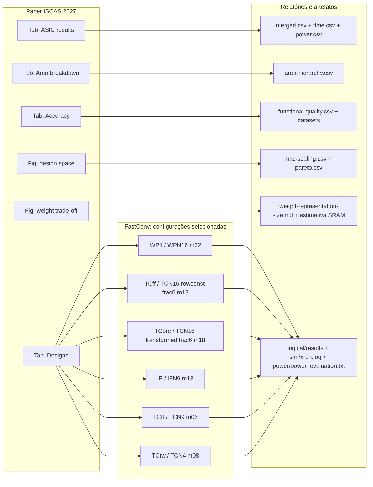

# FastConv no paper ISCAS 2027

Se você chegou ao repositório pelo paper, comece aqui. Este guia liga cada
rótulo do artigo à variante exata de RTL, ao dataset e à configuração ASIC que
geraram o resultado. O paper é a fonte da narrativa e dos valores arredondados;
os diretórios de síntese abaixo são a fonte da evidência bruta.

## Em uma frase

O paper compara núcleos FastConv para uma convolução com entrada `3×32×32`,
`Cout=12`, kernel `3×3`, stride 1, em fluxo ASIC TSMC 28 nm a 500 MHz. A área e
a potência ASIC reportadas são de células do core e **excluem SRAM**. O custo de
memória apresentado em outras análises do paper é estimado/modelado e deve ser
lido separadamente dos resultados medidos pelo fluxo de síntese.

O fluxo descrito no paper é Cadence Genus 21.12 em TSMC 28 nm, com alvo de
500 MHz; Xcelium 23.03 executa a simulação gate-level com SDF, e Joules estima
potência no corner típico (TT, 0,90 V, 25 °C). A área é de células
standard-cell, sem área de routing. Além das variantes FastConv, o estudo também
usou os repositórios locais de SAURIA e WinoCNN como referências externas. Eles
não fazem parte da árvore FastConv nem usam as configurações de síntese daqui.

## Repositórios externos usados no ISCAS 2027

| Repositório local | Papel no estudo | Escopo e ressalvas |
| --- | --- | --- |
| `/home/tarsio/gaph/sauria` | Baseline de convolução direta, sintetizado para arrays de 9, 20 e 36 MACs com operandos de 16 bits. | Inclui controle, core, feeders, array sistólico e gerenciador de somas parciais; SRAMs locais são black boxes e DMA/barramento são modelados pelo testbench. O tempo é medido por simulação gate-level na fronteira interna do acelerador. |
| `/home/tarsio/gaph/WinoCNN` | Referência contextual baseada na implementação HLS mínima suportada, `F(2x2,3x3)`, com 2 PEs e 32 multiplicadores. | O power foi estimado pelo Genus com atividade gate-level funcional, não timing-accurate; só 37% dos timing checks SDF foram anotados. As 153 RAMs internas (~5 Mbit) permaneceram black boxes e foram excluídas da área e potência. O golden foi correspondido com features de 5 bits e pesos de 4 bits. |

Esses resultados são usados no paper, mas não foram produzidos pelos runners nem
pelos relatórios FastConv deste repositório. Suas fronteiras de medição,
precisão e tratamento de memória diferem; compare-os como pontos de referência
no espaço de projeto, não como medições perfeitamente equivalentes às variantes
FastConv. As descrições acima seguem a metodologia reportada no artigo.

## Do nome no paper ao código

| Nome no paper | Família e ponto escolhido | RTL usado | Configuração ASIC | Dataset |
| --- | --- | --- | --- | --- |
| `WPff`, 32 mult. | WPN16, 4×4, 16 bits | [`RTL`](../../rtl/conv4x4/conv-wpn16-i60-h41-t64-o16-m32-stream16-prefetch24-rowconst8-trunc-column.sv) | [`m32, 16-bit, Cin3/Cout12`](../../rtl/conv4x4/synthesis/conv-wpn16-i60-h41-t64-o16-m32-stream16-prefetch24-rowconst8-trunc-column-nbits16-cin3-cout12/) | [`WPN16 16-bit, 3→12`](../../rtl/conv4x4/data/wpn16/sim/sim-032-3-12-normal-trunc-nbits16/) |
| `TCff`, 18 mult. | TCN16, transformação do kernel on-chip; palavras de 20 bits, parâmetro `frac6` | [`RTL arquivado, mas usado pelo fluxo`](../../rtl/conv4x4/archive/conv-tcn16-i60-h27-t36-o16-m18-stream12-prefetch24-rowconst6-trunc-frac6-column.sv) | [`m18 rowconst, Cin3/Cout12`](../../rtl/conv4x4/synthesis/conv-tcn16-i60-h27-t36-o16-m18-stream12-prefetch24-rowconst6-trunc-frac6-column-cin3-cout12/) | [`TCN16 20-bit frac6, 3→12`](../../rtl/conv4x4/data/tcn16/sim/sim-032-3-12-normal-trunc-frac6-nbits20/) |
| `TCpre`, 18 mult. | TCN16, kernel transformado previamente; palavras de 20 bits, parâmetro `frac6` | [`RTL transformed-frac6`](../../rtl/conv4x4/conv-tcn16-i60-h27-t36-o16-m18-stream12-prefetch24-transformed-frac6-column.sv) | [`m18 transformed, Cin3/Cout12`](../../rtl/conv4x4/synthesis/conv-tcn16-i60-h27-t36-o16-m18-stream12-prefetch24-transformed-frac6-column-cin3-cout12/) | [`Mesmo pacote TCN16 frac6`](../../rtl/conv4x4/data/tcn16/sim/sim-032-3-12-normal-trunc-frac6-nbits20/) |
| `IF`, 18 mult. | IFN9, 3×3, 16 bits | [`RTL`](../../rtl/conv3x3/conv-ifn9-i40-h27-t36-o9-m18-stream12-prefetch15-rowconst6-trunc-column.sv) | [`m18, Cin3/Cout12`](../../rtl/conv3x3/synthesis/conv-ifn9-i40-h27-t36-o9-m18-stream12-prefetch15-rowconst6-trunc-column-nbits16-cin3-cout12/) | [`IFN9 16-bit, 3→12`](../../rtl/conv3x3/data/ifn9/sim/sim-032-3-12-normal-trunc-nbits16/) |
| `TCtt`, 5 mult. | TCN9, 3×3, 16 bits | [`RTL`](../../rtl/conv3x3/conv-tcn9-i40-h14-t10-o9-m05-stream10-prefetch15-rowconst5-trunc-column.sv) | [`m05, Cin3/Cout12`](../../rtl/conv3x3/synthesis/conv-tcn9-i40-h14-t10-o9-m05-stream10-prefetch15-rowconst5-trunc-column-nbits16-cin3-cout12/) | [`TCN9 16-bit, 3→12`](../../rtl/conv3x3/data/tcn9/sim/sim-032-3-12-normal-trunc-nbits16/) |
| `TCtw`, 8 mult. | TCN4, 2×2, 16 bits | [`RTL`](../../rtl/conv2x2/conv-i24-h13-t08-o4-m08-stream08-prefetch8-rowconst4-trunc-column.sv) | [`m08, Cin3/Cout12`](../../rtl/conv2x2/synthesis/conv-i24-h13-t08-o4-m08-stream08-prefetch8-rowconst4-trunc-column-nbits16-cin3-cout12/) | [`TCN4 16-bit, 3→12`](../../rtl/conv2x2/data/tcn4/sim/sim-032-3-12-normal-trunc-nbits16/) |

Os caminhos e SHA-256 de todas as fontes e pacotes estão registrados em
[`paper-config-map.csv`](paper-config-map.csv). O `list-file.txt` de cada
configuração é a referência final para saber qual arquivo o fluxo realmente
compilou. Isso importa especialmente para `TCff`: o RTL está arquivado na árvore
de fontes, mas continua explicitamente referenciado por uma configuração ativa
e completa.

## Valores da Tabela ASIC

Os números abaixo são os valores precisos do consolidado local; o paper os
arredonda para uma ou duas casas conforme a coluna. O tempo corresponde à
simulação do job no fluxo a 500 MHz; energia é `potência × tempo`.

| Paper | Ciclos | Tempo (µs) | Área de células (µm²) | Potência (mW) | Energia (nJ) |
| --- | ---: | ---: | ---: | ---: | ---: |
| `WPff`, m32 | 21.533 | 43,066 | 36.360,324 | 9,55099 | 411,323 |
| `TCff`, m18 | 21.533 | 43,066 | 102.774,672 | 14,25950 | 614,100 |
| `TCpre`, m18 | 21.641 | 43,282 | 41.071,968 | 12,14540 | 525,677 |
| `IF`, m18 | 29.740 | 59,480 | 22.464,036 | 7,07957 | 421,093 |
| `TCtt`, m05 | 40.540 | 81,080 | 26.980,884 | 4,43671 | 359,728 |
| `TCtw`, m08 | 57.998 | 115,996388 | 10.840,536 | 3,31780 | 384,853 |

Esses valores não incluem SRAM. Não compare diretamente a energia acima com
uma coluna que some acessos SRAM estimados sem explicitar a fronteira. A
metodologia e as ressalvas estão no paper; a estimativa SRAM separada para
WPN16 também está documentada em
[`sram-macro-wpn16-m32-estimate.md`](../sram-macro-wpn16-m32-estimate.md).

## Precisão dos seis pontos selecionados

Esta expansão vem dos vetores e de `functional-quality.csv`; a tabela de
precisão do paper mostra somente WPff, TCff, TCpre e a truncagem simples do
TCN16. MAE e erro máximo abaixo estão em unidades da saída de referência
float; `R²` é o valor calculado pela biblioteca para o dataset.

| Paper | Dataset/representação | MAE | Erro abs. máximo | R² |
| --- | --- | ---: | ---: | ---: |
| `WPff` | WPN16, 16 bits | 0,054490 | 0,242084 | 0,999827 |
| `TCff` | TCN16, 20 bits, `frac6` | 0,129911 | 0,835101 | 0,998524 |
| `TCpre` | TCN16, 20 bits, `frac6` | 0,129911 | 0,835101 | 0,998524 |
| `IF` | IFN9, 16 bits | 0,052033 | 0,133329 | 0,999903 |
| `TCtt` | TCN9, 16 bits | 0,168611 | 0,926088 | 0,998359 |
| `TCtw` | TCN4, 16 bits | 0,029872 | 0,142533 | 0,999962 |

No conjunto TCN16, `NBITS=20` é a largura da palavra e `frac6` identifica o
parâmetro `WEIGHT_TRANSFORM_FRAC_BITS=6` da transformação dos pesos; não some
20+6 para interpretar uma palavra de 26 bits. Há uma diferença de redação a
resolver no artigo: o parágrafo de validade funcional de `main.tex` menciona
“four extra fractional bits”, enquanto o RTL e o pacote usados pelos fluxos
selecionados registram `WEIGHT_TRANSFORM_FRAC_BITS=6`. Este guia segue os
artefatos efetivamente compilados; confirme/alinhe a frase do artigo antes de
usar essa descrição como texto final.

## Como os blocos do artigo se ligam às evidências



| Parte do paper | Evidência no FastConv | Como interpretar |
| --- | --- | --- |
| Tabela de designs e varreduras | [`mac-scaling.csv`](../mac-scaling.csv), [`time.csv`](../time.csv), [`power.csv`](../power.csv) | A tabela do paper escolhe um ponto por família; a varredura contém outros números de MACs. |
| Tabela ASIC | [`merged.csv`](../merged.csv) e [`flow-status.csv`](../flow-status.csv) | Confirme a linha exata e que síntese, simulação, SDF e power estão marcados completos. |
| Decomposição de área | [`area-hierarchy.csv`](../area-hierarchy.csv) e relatórios Genus em cada `logical/results/reports/` | Valores por bloco devem ser lidos no escopo da síntese ASIC, sem confundir hierarquia RTL e área de memória externa. |
| Precisão | [`functional-quality.csv`](../functional-quality.csv) e `metrics.json` junto aos vetores | R²/MAE/max error pertencem ao dataset indicado; `TCff` e `TCpre` compartilham o dataset `frac6`. |
| Figura de espaço de projeto | [`pareto.csv`](../pareto.csv), [`mac-scaling.csv`](../mac-scaling.csv), `time.csv` e `power.csv` | Esses relatórios cobrem os pontos FastConv; SAURIA/WinoCNN vêm de fontes externas citadas no paper. |
| Trade-off de pesos/memória | [`weight-representation-size.md`](../weight-representation-size.md), [estimativa SRAM WPN16](../sram-macro-wpn16-m32-estimate.md) | O primeiro compara contagens de coeficientes; a estimativa SRAM é modelo separado, não medição Joules do core. Os dados exatos das curvas do paper ficam no repositório do artigo. |

## Reprodução e proveniência

Para regenerar as tabelas a partir das configurações ativas:

```bash
make report
make metrics
```

Para auditar um ponto, abra o diretório linkado na tabela acima:

- `list-file.txt`: fontes e pacote de dados passados ao runner;
- `logical/results/reports/`: área, timing e contagem de células do Genus;
- `sim/xrun.log`: conclusão funcional e contagem de ciclos do Xcelium;
- `power/power_evaluation.txt`: estimativa Joules e categorias de potência;
- `flow-status.csv`: presença/completude das etapas da campanha.

Para refazer EDA, use o nome exato do diretório de configuração com os alvos
`make synth`, `make gate-sim`, `make power` ou `make flow` descritos no README
raiz. Execute jobs longos em `tmux`; uma pasta de configuração, sozinha, não
prova que o fluxo terminou.

O CSV de crosswalk inclui SHA-256 do RTL e do `pack_data.sv` no snapshot em que
este mapa foi preparado. Se qualquer hash mudar, revalide o ponto antes de
tratar os valores como reprodução exata do paper.
